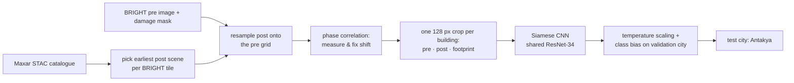

# Enkaz

**Building-level damage assessment from satellite imagery for the 6 February 2023 Kahramanmaraş
earthquakes, tested on a city the model has never seen.**

*Enkaz* is Turkish for *rubble*. The earthquakes of 6 February 2023 (Mw 7.8 and Mw 7.5) damaged or
destroyed hundreds of thousands of buildings across eleven provinces. In the first days, search and
rescue teams and damage assessors have to decide where to look first. Very-high-resolution
satellite images become available within one or two days, but turning them into a building-by-building
damage map has largely been manual work.

This project trains a model that compares a building's **pre-event** and **post-event** image and
outputs a damage class (intact / damaged / destroyed) with a **calibrated probability**, so buildings
can be ranked for a first look. It is evaluated the way it would be used: trained on some cities and
measured on **Antakya**, a city held out completely from training and model selection.

> **Status:** research prototype. Everything below was run end to end on a Colab T4: data
> pipeline, alignment, training and evaluation on the held-out city. See
> [Limitations](#limitations): this is not an operational damage-assessment product.

## Data

| Source | What it gives | Licence |
|---|---|---|
| [Maxar Open Data Program](https://www.maxar.com/open-data), event *Kahramanmaras-turkey-earthquake-23* | post-event optical imagery (~0.3–0.5 m), STAC catalogue | CC BY-NC 4.0 |
| [BRIGHT](https://huggingface.co/datasets/Kullervo/BRIGHT) (Chen et al., 2025), Türkiye subset | pre-event optical tiles and per-building damage masks derived from Copernicus EMS gradings | see dataset card |
| [Copernicus EMS EMSR648](https://mapping.emergency.copernicus.eu/activations/EMSR648/) | independent damage gradings (used for reference only) | © European Union |
| [geoBoundaries](https://www.geoboundaries.org/) TUR ADM1 | the 81 provinces, for the data-coverage table | CC BY-SA |

BRIGHT ships pre-event optical images and post-event **SAR**. We pair each BRIGHT tile with the
earliest suitable post-event **optical** Maxar scene ourselves, so pre and post are both optical.

## Method



1. **Pairing.** For every BRIGHT tile the earliest post-event Maxar scene with ≤ 45° off-nadir and
   ≤ 10 % cloud is chosen (later scenes increasingly show debris removal). Scenes on a tile edge are
   mosaicked.
2. **Co-registration.** Pre and post images from different satellites and angles are shifted by
   several metres. The shift is measured by phase correlation of gradient images and applied only if
   it increases the correlation.
3. **Buildings.** BRIGHT building polygons where available (1,001 tiles); elsewhere connected
   components of the damage mask (113 tiles; touching buildings may merge).
4. **Models.** All see a 128 × 128 crop (~45 m) centred on the building plus its footprint mask:
   * *Change score* (no learning): 1 − correlation of pre/post gradients inside the footprint, with
     two thresholds tuned on the validation city.
   * *Post-only CNN*: ResNet-34 (ImageNet) on the post crop only.
   * *Siamese CNN*: the same encoder on pre and post, head on [pre, post, post − pre] features.
5. **Training.** Class-balanced sampling (∝ √count), label smoothing, rotations/flips, colour
   jitter, and a ±3 px random shift to tolerate residual misalignment. 8 epochs on a Colab T4.
6. **Calibration and decision rule.** Temperature scaling and per-class logit offsets are fitted on
   the validation city (İslahiye) only, then applied unchanged to the test city.

## Geographic split

| Split | Cities | Buildings | Damaged | Destroyed |
|---|---|---:|---:|---:|
| train | Kahramanmaraş, Adıyaman, Malatya, Gaziantep, Osmaniye | 106,583 | ≈1,400 | ≈1,090 |
| validation | İslahiye | 6,456 | 278 | 133 |
| **test** | **Antakya** | **13,555** | **1,637** | **828** |

Random splits leak: neighbouring buildings share roofs, shadows and acquisition conditions. Splitting
by city measures what matters in a new disaster: performance on a place the model has never seen.

## Results

Test city **Antakya**: 13,555 buildings (11,090 intact, 1,637 damaged, 828 destroyed), never seen in
training, model selection or threshold tuning.

| Method | Macro-F1 | F1 intact | F1 damaged | F1 destroyed | AUROC¹ | Destroyed found in top 10 %² | ECE³ |
|---|---:|---:|---:|---:|---:|---:|---:|
| Change score (no learning) | 0.324 | 0.698 | 0.135 | 0.138 | 0.573 | 10 % | – |
| Post-only CNN | 0.465 | 0.868 | 0.147 | 0.379 | 0.736 | 55 % | 0.075 |
| Post-only CNN + val-tuned thresholds | **0.490** | 0.827 | **0.242** | **0.403** | **0.736** | **55 %** | 0.075 |
| Siamese CNN | 0.439 | 0.838 | 0.139 | 0.341 | 0.732 | 51 % | 0.121 |
| Siamese CNN + val-tuned thresholds *(selected on validation)* | 0.436 | 0.712 | 0.237 | 0.359 | 0.732 | 51 % | 0.121 |

¹ damaged-or-destroyed vs intact, ranked by expected severity. ² share of destroyed buildings found
by inspecting the 10 % of buildings the method ranks highest. ³ expected calibration error after
temperature scaling fitted on İslahiye (lower is better).

What this says:

* **Learning helps a lot over a hand-made change score.** Reading the top 10 % of the model's ranking
  finds 51–55 % of all destroyed buildings in Antakya, against 10 % for the change score, which is
  barely better than random. For a team deciding where to look first, this ranking is the useful
  output.
* **The pre-event image did not help here,** which goes against the usual expectation. On the
  validation city the two models were tied after threshold tuning (macro-F1 0.524 Siamese vs 0.521
  post-only), so the protocol picked the Siamese model. On Antakya the post-only model is better on
  every metric. The likely reasons are cross-sensor pre/post pairs, post scenes taken up to 44° off-nadir and
  a residual shift of a few metres after co-registration. A pixel-level comparison of pre and post
  imagery is only as good as their alignment.
* **"Damaged" stays hard** (F1 ≤ 0.24). Threshold tuning raises its recall, but for the Siamese
  model the offset tuned on İslahiye (+2.6) is far too strong for Antakya: 4,000 intact buildings are
  called damaged. A decision threshold does not transfer between cities as well as the ranking does.
* **Calibration does not transfer perfectly either.** ECE is ≈ 0.01 on the validation city where
  the temperature was fitted, and 0.08–0.12 on Antakya.

The [web page](site/) shows the Antakya map and a before/after gallery of correct and wrong
predictions, using the model the protocol selected.

## Limitations

* **Labels come from expert gradings, not ground inspections.** BRIGHT transfers Copernicus EMS
  gradings to building polygons; the earliest gradings under-report damage in some areas.
* **Satellites see roofs.** Pancake collapses can look intact from above; damage to walls and lower
  floors is invisible. An "intact" prediction is not a safety assessment.
* **Off-nadir and misalignment.** Post scenes in Adıyaman and Malatya were taken at ~44° off-nadir;
  building lean and a residual shift of a few metres remain after co-registration.
* **Class imbalance.** About 4 % of buildings are damaged or destroyed. "Damaged" is the hardest
  class: its visual signature is subtle and its boundary with the other classes is fuzzy.
* **One event, one region.** Building stock, imagery and labelling practice differ elsewhere.
* **Non-commercial imagery licence** (CC BY-NC 4.0): the trained weights and derived maps inherit it.

## Reproduce

Everything runs from [`notebooks/train.ipynb`](notebooks/train.ipynb) on Google Colab (T4 GPU,
Google Drive for persistent storage). Every stage writes a marker to Drive and is skipped when the
notebook is re-run, so a disconnected session resumes where it stopped.

```bash
pip install -e ".[dev]"
pytest -q          # CPU-only tests, no network
ruff check .
```

## Credits

Imagery © Maxar Technologies, Maxar Open Data Program (CC BY-NC 4.0). Labels: BRIGHT (Chen et al.,
2025). Reference gradings © European Union, Copernicus Emergency Management Service (EMSR648).

In memory of the more than 50,000 people who lost their lives in Türkiye on 6 February 2023.
