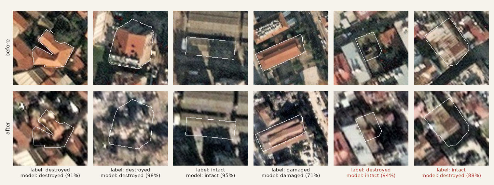
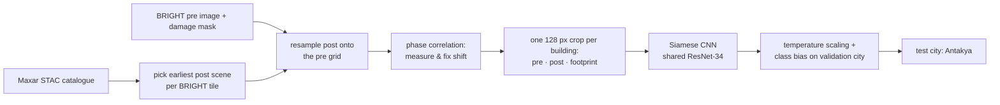
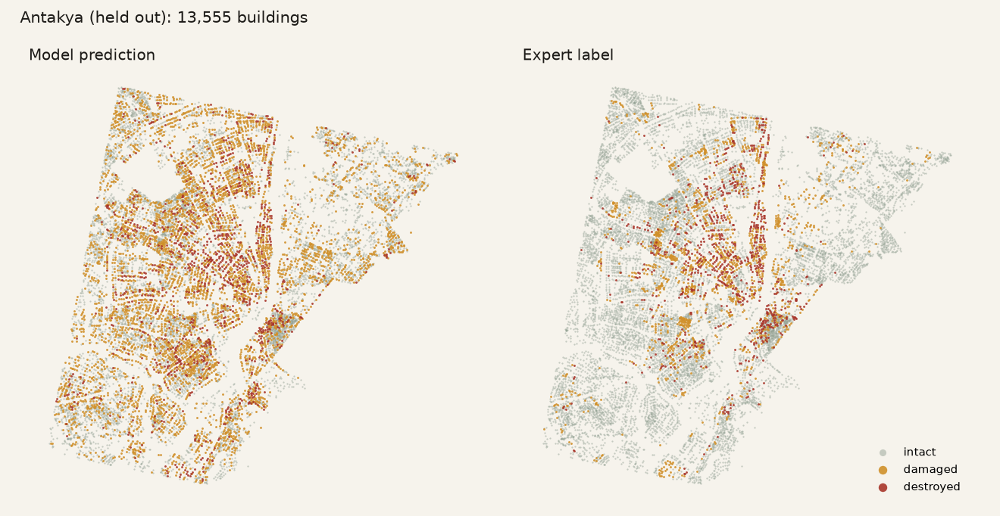

# Enkaz

**Building-level damage assessment from satellite imagery for the 6 February 2023 Kahramanmaraş
earthquakes, tested on a city the model has never seen.**

*Enkaz* is Turkish for *rubble*. The earthquakes of 6 February 2023 (Mw 7.8 and Mw 7.5) damaged or
destroyed hundreds of thousands of buildings across eleven provinces. In the first days, search and
rescue teams and damage assessors have to decide where to look first. Very-high-resolution
satellite images become available within one or two days, but turning them into a building-by-building
damage map has largely been manual work.

This project trains a model that compares a building's **pre-event** and **post-event** image and
outputs a damage class (intact / damaged / destroyed) with a **calibrated probability**, so buildings
can be ranked for a first look. It is evaluated the way it would be used: trained on some cities and
measured on **Antakya**, a city held out completely from training and model selection.

> **Status:** research prototype. Everything below was run end to end on a Colab T4: data
> pipeline, alignment, training and evaluation on the held-out city. See
> [Limitations](#limitations): this is not an operational damage-assessment product.

**[Open the interactive page →](https://emrtunali.github.io/enkaz/)** (before/after slider, Antakya
map with model vs expert labels, results).



*Six buildings from the held-out test city. The outline is the building footprint the model is asked
about. The last two are errors: a collapse that looks like an intact roof from above, and an intact
building called destroyed.*

## Data

| Source | What it gives | Licence |
|---|---|---|
| [Maxar Open Data Program](https://www.maxar.com/open-data), event *Kahramanmaras-turkey-earthquake-23* | post-event optical imagery (~0.3–0.5 m), STAC catalogue | CC BY-NC 4.0 |
| [BRIGHT](https://huggingface.co/datasets/Kullervo/BRIGHT) (Chen et al., 2025), Türkiye subset | pre-event optical tiles and per-building damage masks derived from Copernicus EMS gradings | see dataset card |
| [Copernicus EMS EMSR648](https://mapping.emergency.copernicus.eu/activations/EMSR648/) | independent damage gradings (used for reference only) | © European Union |
| [geoBoundaries](https://www.geoboundaries.org/) TUR ADM1 | the 81 provinces, for the data-coverage table | CC BY-SA |

BRIGHT ships pre-event optical images and post-event **SAR**. We pair each BRIGHT tile with the
earliest suitable post-event **optical** Maxar scene ourselves, so pre and post are both optical.

## Method



1. **Pairing.** For every BRIGHT tile the earliest post-event Maxar scene with ≤ 45° off-nadir and
   ≤ 10 % cloud is chosen (later scenes increasingly show debris removal). Scenes on a tile edge are
   mosaicked.
2. **Co-registration.** Pre and post images from different satellites and angles are shifted by
   several metres. The shift is measured by phase correlation of gradient images and applied only if
   it increases the correlation.
3. **Buildings.** BRIGHT building polygons where available (1,001 tiles); elsewhere connected
   components of the damage mask (113 tiles; touching buildings may merge).
4. **Models.** All see a 128 × 128 crop (~45 m) centred on the building plus its footprint mask:
   * *Change score* (no learning): 1 − correlation of pre/post gradients inside the footprint, with
     two thresholds tuned on the validation city.
   * *Post-only CNN*: ResNet-34 (ImageNet) on the post crop only.
   * *Siamese CNN*: the same encoder on pre and post, head on [pre, post, post − pre] features.
5. **Training.** Class-balanced sampling (∝ √count), label smoothing, rotations/flips, colour
   jitter, and a ±3 px random shift to tolerate residual misalignment. 8 epochs on a Colab T4.
6. **Calibration and decision rule.** Temperature scaling and per-class logit offsets are fitted on
   the validation city (İslahiye) only, then applied unchanged to the test city.

### Training details

| | |
|---|---|
| Input | 128 × 128 px crop per building (~45 m), RGB + footprint mask as a 4th channel |
| Encoder | ResNet-34, ImageNet weights ([timm](https://github.com/huggingface/pytorch-image-models)); shared between pre and post in the Siamese model |
| Optimiser | AdamW, lr 3·10⁻⁴, weight decay 0.05, one-cycle schedule (10 % warm-up) |
| Loss | cross-entropy, label smoothing 0.05 |
| Sampling | class-balanced, weights ∝ √(class count) |
| Batch / epochs | 128 / 8, mixed precision (fp16) |
| Model selection | best validation macro-F1 over epochs, on İslahiye |
| Hardware / time | one Colab T4: 54 min (Siamese), 51 min (post-only) |
| Data volume | ~127 k buildings in 1,114 tiles; crops stored as compressed `.npz` on Google Drive |

## Geographic split

| Split | Cities | Buildings | Damaged | Destroyed |
|---|---|---:|---:|---:|
| train | Kahramanmaraş, Adıyaman, Malatya, Gaziantep, Osmaniye | 106,583 | ≈1,400 | ≈1,090 |
| validation | İslahiye | 6,456 | 278 | 133 |
| **test** | **Antakya** | **13,555** | **1,637** | **828** |

Random splits leak: neighbouring buildings share roofs, shadows and acquisition conditions. Splitting
by city measures what matters in a new disaster: performance on a place the model has never seen.

## Results

Test city **Antakya**: 13,555 buildings (11,090 intact, 1,637 damaged, 828 destroyed), never seen in
training, model selection or threshold tuning.

| Method | Macro-F1 | F1 intact | F1 damaged | F1 destroyed | AUROC¹ | Destroyed found in top 10 %² | ECE³ |
|---|---:|---:|---:|---:|---:|---:|---:|
| Change score (no learning) | 0.324 | 0.698 | 0.135 | 0.138 | 0.573 | 10 % | – |
| Post-only CNN | 0.465 | 0.868 | 0.147 | 0.379 | 0.736 | 55 % | 0.075 |
| Post-only CNN + val-tuned thresholds | **0.490** | 0.827 | **0.242** | **0.403** | **0.736** | **55 %** | 0.075 |
| Siamese CNN | 0.439 | 0.838 | 0.139 | 0.341 | 0.732 | 51 % | 0.121 |
| Siamese CNN + val-tuned thresholds *(selected on validation)* | 0.436 | 0.712 | 0.237 | 0.359 | 0.732 | 51 % | 0.121 |

¹ damaged-or-destroyed vs intact, ranked by expected severity. ² share of destroyed buildings found
by inspecting the 10 % of buildings the method ranks highest. ³ expected calibration error after
temperature scaling fitted on İslahiye (lower is better).

What this says:

* **Learning helps a lot over a hand-made change score.** Reading the top 10 % of the model's ranking
  finds 51–55 % of all destroyed buildings in Antakya, against 10 % for the change score, which is
  barely better than random. For a team deciding where to look first, this ranking is the useful
  output.
* **The pre-event image did not help here,** which goes against the usual expectation. On the
  validation city the two models were tied after threshold tuning (macro-F1 0.524 Siamese vs 0.521
  post-only), so the protocol picked the Siamese model. On Antakya the post-only model is better on
  every metric. The likely reasons are cross-sensor pre/post pairs, post scenes taken up to 44° off-nadir and
  a residual shift of a few metres after co-registration. A pixel-level comparison of pre and post
  imagery is only as good as their alignment.
* **"Damaged" stays hard** (F1 ≤ 0.24). Threshold tuning raises its recall, but for the Siamese
  model the offset tuned on İslahiye (+2.6) is far too strong for Antakya: 4,000 intact buildings are
  called damaged. A decision threshold does not transfer between cities as well as the ranking does.
* **Calibration does not transfer perfectly either.** ECE is ≈ 0.01 on the validation city where
  the temperature was fitted, and 0.08–0.12 on Antakya.



The map uses the model the protocol selected (Siamese + İslahiye thresholds). The dense clusters of
destroyed buildings along the river and in the old town are found, but the "damaged" offset tuned on
İslahiye paints much of the city orange, the transfer problem described above. The
[web page](https://emrtunali.github.io/enkaz/) has the same map interactively (with a
*Disagreements* view) and a before/after gallery of correct and wrong predictions.

## Limitations

* **Labels come from expert gradings, not ground inspections.** BRIGHT transfers Copernicus EMS
  gradings to building polygons; the earliest gradings under-report damage in some areas.
* **Satellites see roofs.** Pancake collapses can look intact from above; damage to walls and lower
  floors is invisible. An "intact" prediction is not a safety assessment.
* **Off-nadir and misalignment.** Post scenes in Adıyaman and Malatya were taken at ~44° off-nadir;
  building lean and a residual shift of a few metres remain after co-registration.
* **Class imbalance.** About 4 % of buildings are damaged or destroyed. "Damaged" is the hardest
  class: its visual signature is subtle and its boundary with the other classes is fuzzy.
* **One event, one region.** Building stock, imagery and labelling practice differ elsewhere.
* **Non-commercial imagery licence** (CC BY-NC 4.0): the trained weights and derived maps inherit it.

## Istanbul: ready for the next one

Istanbul has no post-earthquake imagery and no damage labels, so the model's accuracy there cannot
be measured. What can be prepared is everything around it.
[**The Istanbul page**](https://emrtunali.github.io/enkaz/istanbul.html) maps it per mahalle.

| | |
|---|---|
| Building footprints | **1,200,128** in the 39 districts: 744,105 from OpenStreetMap (outline + area + storeys where tagged), plus 456,023 [Microsoft ML footprints](https://github.com/microsoft/GlobalMLBuildingFootprints) where OSM has no building |
| Boundaries | 39 districts, 964 mahalle (OpenStreetMap) |
| İBB scenario (Mw 7.5, night) | joined for 937 of 959 mahalle: **46,598** very heavily or heavily and 142,523 moderately damaged buildings |
| İBB building stock (2017) | age and height classes, joined for 559 of 571 mahalle |
| Footprint coverage | against İBB's 2017 count, the median mahalle goes from 67 % (OSM alone) to **97 %**; mahalle below half: from 37 % to 8 % |

OSM outlines win wherever both sources have a building; a machine footprint is added only if it
touches no OSM building (`istanbul.merge_footprints`). Footprints are not buildings one to one: in
dense old districts (Beyoğlu, Bağcılar) both sources merge attached buildings into blocks, and in
fast-growing ones (Arnavutköy, Çatalca) the inventory exceeds İBB's 2017 count.

İBB's tables carry no geometry, so they are joined to OSM boundaries by district and normalised
mahalle name (`MAHALLESİ` and diacritics removed, *Eyüp* → *Eyüpsultan*). Ambiguous or renamed
mahalle are left unmatched rather than guessed.

On the day, [`enkaz.respond`](src/enkaz/respond.py) turns released post-event scenes into a ranking:

```bash
python -m enkaz.respond --inventory data/istanbul/buildings.npz \
    --post scene.tif --pre reference.tif \
    --checkpoint runs/main/post_only/best.pt --calibration runs/main/post_only/eval.json \
    --out response/
```

Buildings are grouped into 600 m cells on the local UTM grid. Each cell's post image is resampled to
0.35 m and aligned to a pre-event reference by phase correlation. The same pre/post/footprint crops
as in training are cut, and the logits are calibrated with the İslahiye settings; by default each crop is scored in 8 rotations/flips and the
logits averaged (`--no-tta` turns this off). The output is
`ranking.csv` (every building, highest expected severity first), `top.geojson` (the first 5,000
footprints for a field map) and `mahalle.csv`. The post-only model is the default: it needs no
pre-event image to score buildings, and it held up better on Antakya. The pipeline is tested on
synthetic rasters ([`tests/test_respond.py`](tests/test_respond.py)), not on Istanbul imagery.

### Tested end to end on Antakya

To see whether the pipeline holds up without any of the evaluation's conveniences,
[`scripts/antakya_respond_check.py`](scripts/antakya_respond_check.py) runs it on Antakya exactly
as it would run in Istanbul. Footprints come from an inventory made in advance by someone else,
imagery is the released Maxar acquisition read straight from its COGs, and the checkpoint and
İslahiye calibration are used unchanged. Every labelled building takes the score of the footprint
that contains it (or the nearest within 4 m). The main configuration, fixed before any result was
seen, is *aligned to a pre-event mosaic + test-time augmentation* (8 rotations/flips averaged).

**Which inventory?** OpenStreetMap is no option here. On 1 January 2023 it had **413** buildings in
Antakya (2 % of the labelled ones), and today's OSM has dropped most destroyed buildings (14 % of them
still have a footprint). Microsoft's [Global ML Building Footprints](https://github.com/microsoft/GlobalMLBuildingFootprints)
cover 87 % of the labelled buildings within 4 m. Destroyed buildings are covered as well as intact
ones (92 % vs 86 %), so the footprints predate the earthquake.

Same 11,783 buildings, scored by each method:

| | Macro-F1 | F1 damaged | F1 destroyed | AUROC | Destroyed in top 10 % | ECE | Time (T4) |
|---|---:|---:|---:|---:|---:|---:|---:|
| Evaluation pipeline (BRIGHT polygons, co-registered crops) | 0.490 | 0.247 | 0.405 | 0.733 | **54 %** | 0.083 | – |
| `respond`, single view, no alignment | 0.486 | 0.255 | 0.371 | 0.725 | 47 % | 0.092 | 8 min |
| `respond` + TTA, no alignment | 0.508 | 0.283 | 0.398 | 0.743 | 52 % | 0.053 | 8 min |
| **`respond` + TTA, aligned** *(main)* | **0.510** | 0.280 | **0.406** | **0.743** | 52 % | **0.053** | 23 min |

In this run, a city-wide ranking from released imagery and an inventory nobody drew for this
purpose comes out as good as the evaluation pipeline: slightly better on macro-F1, AUROC and
calibration, and 2 points lower on destroyed buildings in the top 10 %. Test-time augmentation
accounts for most of the gain. Alignment to the pre-event mosaic (median shift 1.75 m) adds
almost nothing for the post-only model, so on the day it can be skipped to save two thirds of the
time: 23,397 buildings in 8 minutes on one GPU. The test-time ranking is also more conservative
about "destroyed" (151 intact buildings called destroyed instead of 586), which a field team will
notice as fewer false alarms at the top of the list. Results:
[`docs/antakya_respond_check.json`](docs/antakya_respond_check.json).

To rebuild the inventory (about 2 minutes on a laptop):

```bash
pip install -e ".[osm]"
python scripts/istanbul_inventory.py turkey-latest.osm.pbf deprem-senaryosu.csv bina-sayilari.csv ms/*.csv.gz
```

The CSVs are İBB's open datasets *Deprem Senaryosu Analiz Sonuçları* and *Mahalle Bazlı Bina
Sayıları*, from [data.ibb.gov.tr](https://data.ibb.gov.tr); `ms/` holds Microsoft's files for the
quadkeys `istanbul.quadkeys(istanbul.BBOX)` returns (listed in `istanbul.MS_LINKS`).

## Responsible use

The output is a **ranking of where to look first**, meant to sit next to expert image analysts and
field teams, not to replace them. It must not be used to declare a building safe, to decide
compensation or demolition, or to stop a search. Probabilities are calibrated on one city and drift
on another (see ECE above), so thresholds should be re-checked against a few hundred quickly graded
buildings in every new area before they are trusted.

## Reproduce

Everything runs from [`notebooks/train.ipynb`](notebooks/train.ipynb) on Google Colab (T4 GPU,
Google Drive for persistent storage). Every stage writes a marker to Drive and is skipped when the
notebook is re-run, so a disconnected session resumes where it stopped.

1. Open the notebook in Colab (*File → Open notebook → GitHub*, `emrtunali/enkaz`) and pick a
   **T4 GPU** runtime.
2. Run **0.1–0.3**: mount Drive, clone and install the code, check the GPU. Everything persistent
   goes to `MyDrive/enkaz`.
3. Run **1.x** (catalogues, ~5 min) and **2.x** (BRIGHT Türkiye download and tile index).
4. Run **3.x**: alignment and crops for all tiles. This is the longest data stage; it resumes per
   tile if the session drops.
5. Run **4.1–4.3**: splits, a one-batch smoke test, then both models (~1 h each on a T4; resumes from
   the last epoch).
6. Run **5.1** (evaluation → `runs/main/results.json`) and **5.2** (web export →
   `runs/main/site_export.zip`). Unzip the export into `site/data/` to update the web page, then
   `python scripts/readme_figures.py` to redraw the README figures.

Locally, without a GPU or network:

```bash
pip install -e ".[dev]"
pytest -q          # CPU-only tests, no network
ruff check .
```

## Project structure

```
src/enkaz/
  data/          Maxar STAC crawler, BRIGHT download (remote zip), Copernicus EMS, provinces
  config.py      storage roots (fast local disk vs Google Drive)
  geo.py         bounding boxes, distances, UTM zones
  prepare.py     phase-correlation co-registration, building extraction, crop packing
  pipeline.py    per-tile run (rasterio): pick post scene, resample, align, write crops
  stages.py      resumable stage runner (markers on Drive)
  learn.py       datasets, Siamese / post-only models, training and evaluation
  metrics.py     macro-F1, ECE, temperature and offset fitting, AUROC, top-k recall (NumPy only)
  export.py      test-city export for the web page
  istanbul.py    Istanbul inventory: OSM footprints and boundaries, İBB scenario join
  respond.py     post-event scenes + footprints + checkpoint -> ranked buildings
notebooks/train.ipynb   the whole run, stage by stage
scripts/                web export, Istanbul inventory, README figures
site/                   static web page (MapLibre), deployed to GitHub Pages
tests/                  CPU-only unit tests
```

## Roadmap

Ideas, roughly in order of expected value:

* **Ranking-first output.** The ranking transfers between cities better than any threshold. Report
  "inspect these N buildings first" per neighbourhood instead of a hard three-class map.
* **SAR as a second post-event view.** BRIGHT already includes post-event SAR, which sees through
  cloud and at night and is not affected by off-nadir lean the same way optical is.
* **Better alignment.** Per-building local co-registration, or footprints projected with the
  satellite's viewing geometry, to reduce the few-metre residual shift that hurt the Siamese model.
* **Stronger models.** Larger backbones, ensembles, and segmentation-style models that use more
  context around each footprint.
* **Istanbul, next steps.** Split block-sized footprints in dense districts (cadastre parcels or
  address points), and repeat the Antakya check on the other 2023 cities to see how stable the
  ranking is from one city to the next.

## Credits

Imagery © Maxar Technologies, Maxar Open Data Program (CC BY-NC 4.0). Labels: BRIGHT (Chen et al.,
2025). Reference gradings © European Union, Copernicus Emergency Management Service (EMSR648).
Istanbul buildings and boundaries © OpenStreetMap contributors (ODbL); machine-made footprints:
Microsoft Global ML Building Footprints (ODbL); scenario estimates and
building stock © İstanbul Büyükşehir Belediyesi (İBB Open Data Licence).

In memory of the more than 50,000 people who lost their lives in Türkiye on 6 February 2023.
